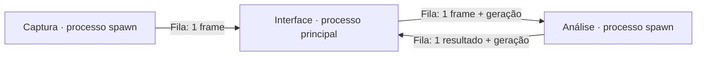

# Aplicação de reconhecimento ao vivo

## Executar

Use Python 3.12 e as dependências já declaradas no projeto. Não há servidor web ou
nova biblioteca de interface. Na raiz do repositório:

```bash
source .venv/bin/activate
python -m pip install -e .
libras-camera --config configs/application.toml
```

Também é possível executar diretamente o módulo, sem atualizar o console script:

```bash
PYTHONPATH=src .venv/bin/python -m application --config configs/application.toml
```

`checkpoint = "auto"` escolhe o `final.pt` associado ao `result.json` concluído mais
recente em `runs/`. Essa seleção usa a data, não a pontuação no teste. Para fixar o
artefato e reproduzir uma demonstração, informe `--checkpoint caminho/final.pt`.
Mantenha `per_class.csv` ao lado dele para mostrar os nomes das palavras; sem esse
arquivo são exibidos os IDs. A ordem dos rótulos é conferida com o checkpoint.

O modelo é criado sem baixar pesos iniciais, recebe os pesos treinados e fica em
modo de avaliação. A aplicação não executa treino e não grava caches do dataset.

| Controle | Efeito |
|---|---|
| ESC ou Q | Encerrar e liberar a câmera e os processos próprios |
| Espaço | Pausar/retomar análise, mantendo a câmera visível e limpando o contexto |
| R | Limpar a janela e a legenda; resultados anteriores em trânsito são descartados |
| `--camera 1` | Usar outra câmera |
| `--device cpu` ou `--device cuda:0` | Fixar o dispositivo; `auto` prefere CUDA disponível |
| `--no-mirror` | Desativar o espelhamento da visualização |
| `--window-seconds 3` | Ajustar o contexto temporal; exige validação experimental |
| `--confidence-threshold 0.7` | Limiar para confirmar uma legenda |

## Janela e reconhecimento

O padrão coleta uma janela de três segundos, reamostra landmarks pelos timestamps
reais a uma frequência nominal de 30 Hz e tenta classificar a cada 0,3 segundo.
A grade contém uma quantidade de frames múltipla de três para que o agrupamento
RGB preserve o frame mais recente. O encoder usa as opções do checkpoint, incluindo
subset, interpolação, ancoragem e representação. `StreamingLandmarkProcessor`, em
`preprocessor/streaming_processor.py`, herda a interpolação/ancoragem e o encoder
do treino e acrescenta somente `prepare_array()`, que trabalha em memória. A classe
de treino e suas assinaturas de cache permanecem inalteradas.

Os três candidatos aparecem como hipóteses. Uma palavra vira legenda após três
previsões consecutivas da mesma classe, com confiança de pelo menos 0,7. Essas
previsões usam janelas sobrepostas; sua concordância é uma regra de estabilidade,
não três evidências independentes nem uma estimativa de precisão.

O painel dos três candidatos fica fixo no canto superior direito. Somente a palavra
principal confirmada acompanha a pessoa, em uma legenda compacta. A janela abre em
1280×720 e pode ser redimensionada; `window_width` e `window_height` controlam seu
tamanho inicial. `width` e `height` controlam a captura e o limite de processamento.

Sem mãos, o contexto de rosto/corpo e as ausências das mãos continuam na janela,
como nos vídeos de treino, mas nenhuma nova classificação é feita e a legenda
anterior é removida. Perda da pessoa, salto grande de posição, pausas e lacunas
longas reiniciam o contexto. O acompanhamento é geométrico, para uma pessoa por
vez; não faz identificação de indivíduos.

O quadro deve mostrar rosto, tronco e mãos. Faça um sinal por vez e observe os
candidatos antes de confirmar a utilidade da legenda. A primeira janela exige
tempo para ser coletada; a classificação de um frame isolado não reconhece o gesto.

## Divisão de responsabilidades

```text
application/
  cli.py              Argumentos e apresentação de erros
  config.py           Configuração e seleção do checkpoint
  types.py            Mensagens compartilhadas entre os componentes
  capture/
    camera.py         Câmera/vídeo, relógio e liberação do dispositivo
  recognition/
    classifier.py     Checkpoint, encoder e inferência
    landmarks.py      Rastreador MediaPipe e seleção dos pontos
    temporal.py       Janela por tempo e estabilidade da palavra
    pipeline.py       Composição do detector, janela e classificador
  runtime/
    app.py            Ciclo de vida e coordenação
    channels.py       Troca de mensagens com capacidade limitada
    worker.py         Processo de análise e invalidação por geração
  ui/
    display.py        Janela OpenCV ou saída sem janela
    overlay.py        Painel fixo de candidatos e legenda móvel
```

Os componentes trocam mensagens, não referências ao modelo ou à câmera. O
controlador não conhece as camadas da rede. Detector/classificador podem ser
substituídos por implementações simuladas nos testes, sem criar um framework de
injeção de dependências. Outros modelos registrados podem ser usados quando seu
checkpoint utiliza os mesmos landmarks e uma representação compatível.



## Concorrência e encerramento

- Cada recurso nativo tem um proprietário: somente a captura usa `VideoCapture`;
  somente a análise usa MediaPipe e o modelo; somente o principal usa HighGUI.
- Filas têm capacidade de uma mensagem. Se o consumidor atrasar, frames podem
  ser descartados em vez de formar uma fila crescente. Não usamos `empty()` ou
  `qsize()` para decidir sincronização. Uma corrida com o feeder pode descartar
  também uma entrada nova: preferimos isso a bloquear a interface.
- Frames carregam ID e `time.monotonic()`. A interface desenha uma cópia; o
  espelhamento nunca troca esquerda/direita nos dados enviados ao modelo.
- Ao pausar ou limpar, aumenta uma geração anexada às entradas e saídas. Uma
  inferência antiga pode terminar, mas seu resultado não é aceito na nova geração.
- Erros retornam por um canal limitado. O controlador libera os componentes em
  `finally`, inclusive quando outro componente falha durante a limpeza.
- O encerramento primeiro pede parada cooperativa. Se uma chamada nativa travar,
  usa `terminate/kill` apenas no processo filho próprio, com prazos limitados. Não
  interfere em outros programas, containers ou processos do usuário.
- No EOF normal, a captura conclui o envio do frame antes de sinalizar fim. Isso
  evita matar o feeder no meio de uma imagem grande. Canais descartados durante
  encerramento forçado não são reutilizados.

Isolamento em processos adiciona serialização e cópias. Um frame BGR de 960×540
ocupa aproximadamente 1,56 MB; câmera→interface e interface→análise podem somar
cerca de 93 MB/s a 30 FPS, antes do overhead e dos descartes. A escolha permite
encerrar bibliotecas nativas bloqueadas sem prender a interface. Memória
compartilhada é uma otimização futura, justificada por medição, não uma dependência
oculta desta primeira versão.

## Verificação sem webcam

```bash
PYTHONPATH=src .venv/bin/python -m application \
  --config configs/application.toml \
  --video data/minds_libras/raw/14FilhoSinalizador03-3.mp4 \
  --window-seconds 1 --device cpu --headless --max-seconds 15
```

Arquivos são reproduzidos pelo FPS informado pelo vídeo, com fallback ao FPS da
configuração quando o backend não informa um valor válido. A captura só começa
depois de carregar o modelo, preservando o início do arquivo. Ao terminar, o
console imprime contagens da sessão e os últimos candidatos. Essas contagens
representam mensagens recebidas, não todas as exposições físicas do sensor.
Antes de enviar um frame entre processos, a captura reduz imagens que excedem
`width × height`, mantendo a proporção, sem recortar ou ampliar. Esse limite
também vale para webcams que ignoram a resolução solicitada.
Esse vídeo é curto: a janela reduzida do exemplo serve para exercitar a inferência,
não para reproduzir a acurácia do experimento offline. No uso ao vivo, o padrão
de três segundos prepara o contexto antes dos primeiros candidatos.

```bash
PYTHONPATH=src .venv/bin/python -m unittest discover -s tests
```

Os testes usam vídeo pequeno real e componentes simulados para validar EOF,
falhas, encerramento de chamadas travadas, invalidação de respostas antigas,
paridade do pré-processamento e desenho sem alterar a entrada. A fluidez real e
a abertura da webcam devem ser verificadas no equipamento de uso.

## Limites de interpretação

O checkpoint aprendeu 20 sinais isolados de vocabulário fechado. Uma janela pode
misturar sinais, repouso e transições. Limiar, presença de mãos e estabilidade
reduzem ruído, mas não criam uma classe confiável de “nenhum sinal” nem detectam
qualquer sinal desconhecido. A legenda mostra uma palavra estabilizada; não
concatena frases nem a apresenta como tradução semântica.

Reamostragem, iluminação, distância, câmera e janela deslizante mudam as condições
do experimento offline. Os 93% do teste reservado não são uma estimativa de acerto
da webcam. É necessário coletar e avaliar sessões ao vivo. A confiança softmax
também não foi calibrada como probabilidade de acerto.

O footer distingue frames recebidos da câmera, análises recebidas, idade do
resultado e duração da classificação. Uma câmera de 30 FPS não garante 30 novas
classificações por segundo; a coleta da janela também faz parte da latência.

## Fontes que orientaram a arquitetura

- [Lugaresi et al., MediaPipe: A Framework for Building Perception Pipelines (2019)](https://arxiv.org/abs/1906.08172): decomposição de percepção em componentes de fluxo e avaliação na plataforma real.
- [Reactive Streams](https://www.reactive-streams.org/): limites explícitos entre produtores e consumidores. Aplicamos o princípio de canais limitados; não implementamos o protocolo Reactive Streams.
- [Python — multiprocessing](https://docs.python.org/3.12/library/multiprocessing.html): `spawn`, serialização, filas, feeder e cuidados com encerramento. Os testes cobrem a transferência de frames maiores que o pipe.
- [PyTorch — inference_mode](https://docs.pytorch.org/docs/stable/generated/torch.autograd.grad_mode.inference_mode.html): aplicado no contexto que executa inferência, além de `model.eval()`.
- [OpenCV — HighGUI](https://docs.opencv.org/4.x/d7/dfc/group__highgui.html): processamento periódico de eventos com `waitKey`; a interface permanece no processo principal por portabilidade.
- [MediaPipe — SolutionBase](https://github.com/google-ai-edge/mediapipe/blob/master/mediapipe/python/solution_base.py): estado do rastreador e relógio interno. Os timestamps reais da aplicação são mantidos separadamente.
