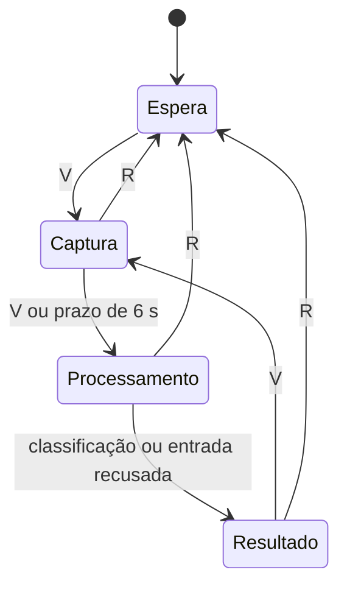

# Aplicação de demonstração — captura com a tecla V

## Executar

Na raiz do projeto, com Python 3.12 e as dependências instaladas:

```bash
source .venv/bin/activate
python -m pip install -e .
libras-camera --config configs/application.toml
```

A configuração fixa o checkpoint em
`runs/minds_libras/search_df534cae53ec/final/test_05/e06d86e0c687/final.pt`.
Também é possível informar a pasta do modelo:

```bash
libras-camera --mode manual \
  --checkpoint runs/minds_libras/search_df534cae53ec/final/test_05/e06d86e0c687 \
  --capture-seconds 6 --device auto
```

Sem atualizar o console script após uma alteração:

```bash
PYTHONPATH=src .venv/bin/python -m application --config configs/application.toml
```

Mantenha `per_class.csv` junto do checkpoint para carregar os nomes das 20 palavras.
A ordem dos rótulos é conferida com `class_to_index`. Sem o CSV, aparecem os IDs.
`auto` seleciona CUDA disponível ou CPU. Não há novo treinamento nem download de
pesos iniciais ao carregar o modelo treinado.

## Como apresentar

1. Aguarde o carregamento do modelo e o vídeo da câmera aparecer.
2. Com a janela em foco, pressione **V**. A contagem de seis segundos começa.
3. Execute **um sinal uma vez**, mostrando rosto, tronco e mãos. Pressione **V
   novamente** assim que terminar. A barra mostra o limite máximo de seis segundos;
   não é preciso completar esse prazo nem repetir o sinal para preenchê-lo.
4. Ao terminar, aguarde o processamento. A legenda aparece em uma faixa **abaixo
   do vídeo**, com os três candidatos e suas confidências no canto superior direito.
5. O resultado fica visível até **V** iniciar outra captura ou **R** limpar.

| Tecla | Ação |
|---|---|
| V | Iniciar; durante a captura, finalizar mais cedo; durante o processamento, ignorar |
| R | Cancelar a captura ou limpar o resultado; respostas antigas são invalidadas |
| ESC / Q | Encerrar e liberar os processos e a câmera |

O controle desenhado `[V] CAPTURAR SINAL` indica a tecla do teclado. Não é um botão
de mouse. O vídeo continua visível durante captura e inferência. A janela abre em
1280×720; `window_width` e `window_height` definem seu tamanho inicial. O vídeo e a
faixa de legenda se adaptam à área útil, sem barras extras do OpenCV. O espelhamento
é somente visual; não altera os dados enviados ao modelo.

## O que acontece durante a captura

A aplicação extrai landmarks enquanto a câmera fornece frames e conserva apenas
os pontos e timestamps do trecho. A contagem usa relógio monotônico; **não** depende
de receber exatamente 180 frames. O modelo classifica o trecho uma única vez após
V encerrar a captura ou o prazo terminar. Há um aquecimento sintético inicial antes da câmera começar;
essa chamada não produz uma legenda nem usa imagens da pessoa.

O encerramento é enviado explicitamente ao processo de análise, mesmo se não
chegar um frame exatamente no instante de parada. A validação usa a duração real
da captura, incluindo uma parada antecipada. Frames anteriores ao comando
e posteriores ao prazo não entram no trecho. Não há tentativa de encontrar uma
fronteira linguística ou de classificar prefixos durante essa captura.

Os pontos são reamostrados no tempo observado a uma frequência nominal de 30 Hz,
com quantidade múltipla de três para o encoder RGB. Em seguida, usam as mesmas
opções do checkpoint: seleção, interpolação, ancoragem e codificação.
`StreamingLandmarkProcessor` trabalha em memória e reaproveita a implementação do
treino. Os vídeos e os pesos do experimento não são modificados.

Uma captura muito curta (menos de 0,6 s no padrão), com lacunas maiores que `max_frame_gap`, cobertura insuficiente
do início/fim ou poucos pontos válidos é recusada. São necessários pelo menos seis
frames, âncoras válidas em metade deles e mãos detectadas em pelo menos três.
Esses controles verificam a entrada, não identificam semanticamente um sinal.
Uma saída abaixo de `confidence_threshold` mostra **Possível: palavra**, em cor
neutra, mantendo os candidatos para inspeção. O limiar não foi reduzido para
esconder incerteza. Softmax não é uma probabilidade calibrada de acerto.
O tempo de classificação mostrado no rodapé inclui reamostragem, preparo da
entrada, encoder e execução do modelo; não é apenas o tempo do forward da rede.

A gravação fica somente em memória como landmarks. Não são gravados vídeos da
webcam, áudios, sessões ou dados pessoais automaticamente.

## Arquitetura

```text
application/
  cli.py                    Comandos e apresentação de erros
  config.py                 Configuração e seleção do checkpoint
  types.py                  Mensagens imutáveis entre os componentes
  capture/
    camera.py               Câmera/arquivo, timestamps e redução de resolução
    session.py              Espera, captura, processamento e resultado
  recognition/
    classifier.py           Checkpoint, encoder e inferência
    clip_pipeline.py        Trecho acionado por V e uma classificação ao final
    landmarks.py            Rastreador MediaPipe e seleção dos pontos
    temporal.py             Buffer limitado e reamostragem
    pipeline.py, captions.py Protótipo contínuo opcional
  runtime/
    app.py                  Loop da janela, teclas e ciclo de vida
    channels.py             Canais de capacidade limitada
    worker.py               Processo de análise e invalidação por geração
  ui/
    display.py              Janela OpenCV ou execução sem janela
    capture_overlay.py      Contagem e legenda abaixo do vídeo
    overlay.py              Primitivas de desenho e interface do modo contínuo
```



A captura, o modelo e a interface têm proprietários separados. Somente a captura
usa `VideoCapture`, somente a análise usa MediaPipe/PyTorch e somente o principal
usa HighGUI. O controlador não conhece as camadas da rede. O estado da demonstração
fica em `CaptureSession`; o preparo do trecho fica em `ClipRecognitionPipeline`.

Filas têm capacidade de uma mensagem. Consumidores lentos podem descartar frames;
lacunas excessivas tornam a captura inválida em vez de provocar acúmulo de atraso.
Não usamos `empty()` ou `qsize()` para sincronizar processos. A ordem de início e
fim acompanha os frames na mesma fila, com um identificador de geração. A finalização
é uma mensagem pequena, sem imagem, enviada uma única vez após aceitação na fila.
Se a fila estiver cheia, o controlador tenta novamente sem remover o último frame.
O resultado final aguarda espaço na saída em vez de ser descartado junto do progresso.
R ou uma nova captura invalidam respostas anteriores, mesmo se uma inferência já começou.

As imagens de entrada são somente leitura; a interface desenha uma cópia. O
encerramento libera os componentes em `finally`. Se uma chamada nativa travar,
`stop()` encerra apenas seus filhos, com prazos limitados. O processamento tem
limite de espera de 30 segundos. Isso não interfere em outros programas ou containers.

O MediaPipe e o classificador são reutilizados entre capturas. Uma nova captura
limpa os pontos e seu estado, sem reiniciar o grafo nativo de detecção.

### Diagnóstico de travadas e confiança

O resumo da sessão inclui `max_ui_interval_ms` (maior intervalo observado entre
iterações do controlador, não uma medição de latência de tela) e `capture_metrics`
do último trecho medido: duração real, quantidade e frequência de landmarks,
fração de frames com mãos/âncoras válidas e maior lacuna de dados.

A paridade foi conferida em CSVs de Filho: o encoder em memória reproduziu as
previsões do experimento, com confiança de aproximadamente 0,994 e 0,992 nos dois
clipes usados no diagnóstico. Acrescentar repouso ao final alterou essas previsões.
Isso não reproduz nem explica sozinho um erro na webcam. A ancoragem corrige a
posição; não normaliza a escala do corpo. Enquadramento, distância, oclusão e
execução diferentes continuam sendo mudanças em relação ao dataset. Não alteramos
os pesos, o encoder de treino ou o limiar para simular uma melhora de acerto.

No replay local de `14FilhoSinalizador03-3`, V foi simulado no início e aos 4,2 s.
Houve uma única inferência, com Filho como hipótese líder e confiança de cerca de
0,991. Essa é uma verificação de integração com vídeo conhecido, não uma estimativa
de acurácia ao vivo. Para investigar uma falha específica, é necessário observar
as condições e os dados da captura que produziu o erro.

Outro teste usou três reproduções do mesmo vídeo como três capturas separadas,
cada uma encerrada por V em cerca de 4,2 s. Foram três inferências, todas com Filho
como líder (confianças aproximadas de 0,994, 0,993 e 0,992). O maior intervalo do
loop foi de cerca de 34 ms nessa execução sem janela, com o desenho da interface
ativo. Isso verifica repetição do fluxo; não mede o compositor gráfico, a webcam
física ou a generalização para outros sinais/pessoas.

## Verificação com arquivo local

Um arquivo de pelo menos seis segundos pode exercitar a captura automaticamente:

```bash
libras-camera --config configs/application.toml \
  --video caminho/video_completo.mp4 --auto-capture --headless \
  --device cpu --max-seconds 20
```

`--auto-capture` inicia **uma** captura ao receber o primeiro frame e exige `--video`.
Arquivos são reproduzidos conforme seu FPS. Um arquivo que termina antes de completar
a duração é recusado; não é artificialmente repetido ou esticado para completar seis
segundos. O resumo informa a quantidade de inferências, candidatos e estado final.

O fluxo completo foi exercitado com o checkpoint indicado, usando um vídeo local
`14FilhoSinalizador03-3` seguido de dois segundos com o último frame parado, sem
repetir o gesto. A captura de seis segundos produziu uma inferência e o candidato
Filho com confiança aproximada de 0,933. É um teste de integração; não uma medição
de acurácia na webcam. O tempo total do processo inclui a inicialização do modelo.

```bash
PYTHONPATH=src .venv/bin/python -m unittest discover -s tests
```

Os testes cobrem o gatilho, prazo, classificação única, recusa de entradas incompletas,
limpeza entre capturas, legenda fora do vídeo, cancelamento, respostas em trânsito
e encerramento. A webcam física deve ser verificada no equipamento da apresentação.

## Limites e modo contínuo

O checkpoint classifica 20 sinais isolados de vocabulário fechado. A janela manual
aproxima o uso dos vídeos delimitados do treinamento, mas iluminação, distância,
pessoa e ritmo diferentes podem reduzir o acerto. Um trecho com vários sinais,
repouso com mãos visíveis ou um sinal desconhecido pode receber uma classe incorreta,
inclusive com confiança alta. O resultado é uma classificação, não uma tradução
semântica de frases de Libras.

O protótipo incremental anterior permanece disponível com `--mode continuous`.
Ele usa janela crescente, hipóteses com reticências, heurísticas de confirmação e
legenda sobre o peito. Suas opções em `application.toml` estão identificadas como
exclusivas desse modo. Para a apresentação com V, o modo padrão é `manual`.

O padrão de interação lembra um controle de captura acionado pelo usuário: entrada
bem delimitada, indicação de ocupado e resultado persistente. A aplicação não
chama serviços de transcrição nem usa áudio.

## Referências de implementação

- [MediaPipe: A Framework for Building Perception Pipelines](https://arxiv.org/abs/1906.08172): componentes de percepção e medição no equipamento real.
- [Python — multiprocessing](https://docs.python.org/3.12/library/multiprocessing.html): spawn, serialização e encerramento de filas/processos.
- [PyTorch — inference_mode](https://docs.pytorch.org/docs/stable/generated/torch.autograd.grad_mode.inference_mode.html): inferência sem autograd, além de `model.eval()`.
- [OpenCV — HighGUI](https://docs.opencv.org/4.x/d7/dfc/group__highgui.html): processamento de eventos e janela no processo principal.
- [Google STT — resultados provisórios/finais](https://docs.cloud.google.com/speech-to-text/docs/reference/rest/v2/StreamingRecognitionResult) e [Whisper-Streaming](https://aclanthology.org/2023.ijcnlp-demo.3/): referências do protótipo incremental; não são componentes do modo manual.
