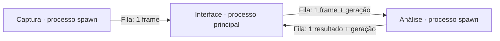

# Aplicação de reconhecimento ao vivo

## Executar

Use Python 3.12 e as dependências já declaradas no projeto. Não há servidor web ou
nova biblioteca de interface. Na raiz do repositório:

```bash
source .venv/bin/activate
python -m pip install -e .
libras-camera --config configs/application.toml
```

Também é possível executar diretamente o módulo, sem atualizar o console script:

```bash
PYTHONPATH=src .venv/bin/python -m application --config configs/application.toml
```

`checkpoint = "auto"` escolhe o `final.pt` associado ao `result.json` concluído mais
recente em `runs/`. Essa seleção usa a data, não a pontuação no teste. Para fixar o
artefato e reproduzir uma demonstração, informe `--checkpoint caminho/final.pt`.
Mantenha `per_class.csv` ao lado dele para mostrar os nomes das palavras; sem esse
arquivo são exibidos os IDs. A ordem dos rótulos é conferida com o checkpoint.

O modelo é criado sem baixar pesos iniciais, recebe os pesos treinados e fica em
modo de avaliação. A aplicação não executa treino e não grava caches do dataset.

| Controle | Efeito |
|---|---|
| ESC ou Q | Encerrar e liberar a câmera e os processos próprios |
| Espaço | Pausar/retomar análise, mantendo a câmera visível e limpando o contexto |
| R | Limpar a janela e a legenda; resultados anteriores em trânsito são descartados |
| `--camera 1` | Usar outra câmera |
| `--device cpu` ou `--device cuda:0` | Fixar o dispositivo; `auto` prefere CUDA disponível |
| `--no-mirror` | Desativar o espelhamento da visualização |
| `--window-seconds 6` | Limitar o contexto temporal; exige validação experimental |
| `--confidence-threshold 0.7` | Limiar para confirmar uma legenda |

## Janela e reconhecimento

O padrão começa a apresentar candidatos após **0,6 segundo** de contexto e tenta
atualizá-los a cada **0,15 segundo**. A janela cresce com os dados disponíveis,
até o limite de **seis segundos**; não precisa estar completa para apresentar
uma hipótese. Ela é reamostrada pelos timestamps reais, sem extrapolar para antes
do primeiro frame. A quantidade de frames é múltipla de três para que o encoder
RGB preserve o instante mais recente.

O encoder usa as opções do checkpoint, incluindo subset, interpolação, ancoragem
e representação. `StreamingLandmarkProcessor`, em
`preprocessor/streaming_processor.py`, herda a interpolação/ancoragem e o encoder
do treino e acrescenta somente `prepare_array()`, que trabalha em memória. A classe
de treino e suas assinaturas de cache permanecem inalteradas.

A política separa **hipótese provisória** e **palavra confirmada**:

1. Com contexto parcial, o melhor candidato pode aparecer como `Palavra…`,
   explicitamente provisório. Ele pode mudar com a chegada de novos frames.
2. Duas previsões consecutivas da mesma classe, com confiança de pelo menos 0,7,
   fornecem a concordância exigida para confirmação. A confirmação só é permitida
   quando a janela chega ao limite completo ou quando uma ausência de mãos de
   0,6 segundo encerra o trecho. Confiança alta num prefixo não basta para declarar
   que o gesto inteiro terminou.
3. Uma palavra confirmada pode continuar visível por **dois segundos**, com prazo
   próprio, enquanto candidatos novos são atualizados. Isso evita apagar uma
   confirmação imediatamente após uma breve perda das mãos. Sua apresentação
   continua condicionada à presença recente da pessoa.

As previsões usam janelas sobrepostas: concordância é uma regra de apresentação,
não evidência independente nem garantia de acerto. A softmax também não fornece
uma medida calibrada de estabilidade ou de correção.

O painel dos três candidatos fica fixo no canto superior direito. A palavra líder
provisória ou a confirmação recente acompanha a pessoa, em uma legenda compacta,
com indicação visual do estado provisório e centralizada no peito, logo abaixo
da cabeça. A posição vem do centro dos ombros
com um deslocamento de um quarto da distância entre eles para baixo, calculado
em pixels e convertido em coordenadas normalizadas. A legenda acompanha essa
âncora, incluindo no modo espelhado, e só é limitada pelas bordas da imagem.
A janela abre em 1280×720 e pode ser
redimensionada; `window_width` e `window_height` controlam seu tamanho inicial.
`width` e `height` controlam a captura e o limite de processamento.
O vídeo preenche toda a área útil da janela, inclusive após redimensioná-la ou
maximizá-la. A exibição adapta a proporção da imagem ao formato da janela, sem
recortar o enquadramento. As barras nativas de ferramentas/status do OpenCV ficam
ocultas. Esse ajuste é apenas visual; a entrada do modelo mantém suas dimensões.

Perdas breves da pessoa ou das coordenadas de ancoragem não apagam imediatamente
o contexto. Quando a falha permanece por 0,6 segundo, ele é limpo; sem pessoa
recente, a legenda é ocultada. Um salto grande de posição, uma pausa/limpeza manual
ou uma lacuna real entre frames maior que 0,35 segundo reinicia o contexto. O
acompanhamento é geométrico, para uma pessoa por vez; não identifica indivíduos.

A ausência de mãos é uma **heurística de encerramento**, não uma fronteira
linguística aprendida. Mãos paradas ou fora do quadro não equivalem a silêncio;
há sinais com sustentação e transições sem pausa. Quando as mãos permanecem
detectadas, a confirmação depende do contexto completo de seis segundos. Essa
política precisa ser avaliada em sinais feitos uma vez, sem repetir artificialmente
o movimento, com repouso e transições. Ela não transforma o checkpoint de sinais
isolados em um modelo de reconhecimento contínuo.

O quadro deve mostrar rosto, tronco e mãos. Faça um sinal por vez e observe a
diferença entre hipótese e confirmação. A legenda não concatena palavras para
inventar uma tradução de frases.

### O que aproveitamos das legendas ao vivo

Sistemas de transcrição podem apresentar resultados provisórios e depois confirmar
um trecho. A API do Google documenta separadamente hipóteses, confirmação e
estabilidade; o Whisper-Streaming confirma texto concordante entre atualizações
sucessivas. Aproveitamos o princípio de **revisar antes de confirmar**, sem alegar
que nosso classificador implementa esses sistemas ou conhece fronteiras de Libras.

Legendas de vídeos gravados do YouTube podem ser processadas antes da reprodução.
Isso é diferente de reconhecer conteúdo que acaba de chegar da câmera. O YouTube
também documenta que as legendas geradas após uma transmissão podem diferir das
que apareceram ao vivo; sua documentação pública não descreve a arquitetura
interna em detalhe.

Um forward de aproximadamente 17 ms, por exemplo, não significa uma legenda
disponível em 17 ms. A latência percebida inclui captura e transporte, extração
dos landmarks, coleta do contexto, preparação, inferência e espera de confirmação.
Para avaliar esta política, precisamos medir o tempo até a primeira hipótese e
até a confirmação, além de sinais perdidos, mudanças de hipótese e inserções em
repouso. O benchmark offline mede apenas parte desse percurso.

O resumo da sessão também registra `first_prediction_seconds` (primeiros
candidatos), `first_partial_caption_seconds` (primeira palavra provisória) e
`first_stable_caption_seconds` (primeira palavra estabilizada). São tempos de
parede desde o primeiro frame recebido até a chegada do resultado ao controlador,
excluindo a carga inicial do modelo. Não identificam automaticamente o instante
linguístico de início do gesto. `null` significa que o estado não ocorreu na sessão.

Em uma verificação local com `14FilhoSinalizador03-3.mp4` reproduzido uma vez,
os candidatos chegaram em cerca de 0,78 s e a palavra provisória em 3,52 s. O último
candidato foi “Filho”; não houve confirmação antes do fim do arquivo. Em outro
teste de integração, acrescentando dois segundos do último frame parado (sem
repetir o gesto), houve estabilização em cerca de 6,21 s. Esses casos exercitam o
fluxo e revelam o atraso restante; não são avaliação de acurácia ou latência geral
da webcam. O limite completo ainda pode demorar quando as mãos não desaparecem.

## Divisão de responsabilidades

```text
application/
  cli.py              Argumentos e apresentação de erros
  config.py           Configuração e seleção do checkpoint
  types.py            Mensagens compartilhadas entre os componentes
  capture/
    camera.py         Câmera/vídeo, relógio e liberação do dispositivo
  recognition/
    classifier.py     Checkpoint, encoder e inferência
    landmarks.py      Rastreador MediaPipe e seleção dos pontos
    temporal.py       Janela crescente, limites e reamostragem por tempo
    captions.py       Hipótese revisável, concordância e validade da palavra
    pipeline.py       Composição do detector, janela e classificador
  runtime/
    app.py            Ciclo de vida e coordenação
    channels.py       Troca de mensagens com capacidade limitada
    worker.py         Processo de análise e invalidação por geração
  ui/
    display.py        Janela OpenCV ou saída sem janela
    overlay.py        Painel fixo de candidatos e legenda móvel
```

Os componentes trocam mensagens, não referências ao modelo ou à câmera. O
controlador não conhece as camadas da rede. Detector/classificador podem ser
substituídos por implementações simuladas nos testes, sem criar um framework de
injeção de dependências. Outros modelos registrados podem ser usados quando seu
checkpoint utiliza os mesmos landmarks e uma representação compatível.



## Concorrência e encerramento

- Cada recurso nativo tem um proprietário: somente a captura usa `VideoCapture`;
  somente a análise usa MediaPipe e o modelo; somente o principal usa HighGUI.
- Filas têm capacidade de uma mensagem. Se o consumidor atrasar, frames podem
  ser descartados em vez de formar uma fila crescente. Não usamos `empty()` ou
  `qsize()` para decidir sincronização. Uma corrida com o feeder pode descartar
  também uma entrada nova: preferimos isso a bloquear a interface.
- Frames carregam ID e `time.monotonic()`. A interface desenha uma cópia; o
  espelhamento nunca troca esquerda/direita nos dados enviados ao modelo.
- Ao pausar ou limpar, aumenta uma geração anexada às entradas e saídas. Uma
  inferência antiga pode terminar, mas seu resultado não é aceito na nova geração.
- Erros retornam por um canal limitado. O controlador libera os componentes em
  `finally`, inclusive quando outro componente falha durante a limpeza.
- O encerramento primeiro pede parada cooperativa. Se uma chamada nativa travar,
  usa `terminate/kill` apenas no processo filho próprio, com prazos limitados. Não
  interfere em outros programas, containers ou processos do usuário.
- No EOF normal, a captura conclui o envio do frame antes de sinalizar fim. Isso
  evita matar o feeder no meio de uma imagem grande. Canais descartados durante
  encerramento forçado não são reutilizados.

Isolamento em processos adiciona serialização e cópias. Um frame BGR de 960×540
ocupa aproximadamente 1,56 MB; câmera→interface e interface→análise podem somar
cerca de 93 MB/s a 30 FPS, antes do overhead e dos descartes. A escolha permite
encerrar bibliotecas nativas bloqueadas sem prender a interface. Memória
compartilhada é uma otimização futura, justificada por medição, não uma dependência
oculta desta primeira versão.

## Verificação sem webcam

```bash
PYTHONPATH=src .venv/bin/python -m application \
  --config configs/application.toml \
  --video data/minds_libras/raw/14FilhoSinalizador03-3.mp4 \
  --device cpu --headless --max-seconds 15
```

Arquivos são reproduzidos pelo FPS informado pelo vídeo, com fallback ao FPS da
configuração quando o backend não informa um valor válido. A captura só começa
depois de carregar o modelo, preservando o início do arquivo. Ao terminar, o
console imprime contagens da sessão e os últimos candidatos. Essas contagens
representam mensagens recebidas, não todas as exposições físicas do sensor.
Antes de enviar um frame entre processos, a captura reduz imagens que excedem
`width × height`, mantendo a proporção, sem recortar ou ampliar. Esse limite
também vale para webcams que ignoram a resolução solicitada.
Esse vídeo é curto: a janela crescente permite exercitar as hipóteses sem esperar
seis segundos. O fim de um arquivo não comprova uma fronteira linguística nem a
acurácia do experimento offline. Avalie também sinais únicos com repouso antes e
depois, sem inserir repetições para conseguir uma confirmação.

```bash
PYTHONPATH=src .venv/bin/python -m unittest discover -s tests
```

Os testes usam vídeo pequeno real e componentes simulados para validar EOF,
falhas, encerramento de chamadas travadas, invalidação de respostas antigas,
paridade do pré-processamento e desenho sem alterar a entrada. A fluidez real e
a abertura da webcam devem ser verificadas no equipamento de uso.

## Limites de interpretação

O checkpoint aprendeu 20 sinais isolados de vocabulário fechado. Uma janela pode
misturar sinais, repouso e transições. Limiar, presença de mãos e estabilidade
reduzem ruído, mas não criam uma classe confiável de “nenhum sinal” nem detectam
qualquer sinal desconhecido. A legenda distingue hipóteses de confirmações; não
concatena frases nem as apresenta como tradução semântica. Localizar onde um
sinal começa e termina em vídeo contínuo é outro problema, estudado como
segmentação temporal e sign spotting.

Reamostragem, iluminação, distância, câmera e janela deslizante mudam as condições
do experimento offline. Os 93% do teste reservado não são uma estimativa de acerto
da webcam. É necessário coletar e avaliar sessões ao vivo. A confiança softmax
também não foi calibrada como probabilidade de acerto.

O footer distingue frames recebidos da câmera, análises recebidas, idade do
resultado e duração da classificação. Uma câmera de 30 FPS não garante 30 novas
classificações por segundo; a coleta da janela também faz parte da latência.

## Fontes que orientaram a arquitetura

- [Lugaresi et al., MediaPipe: A Framework for Building Perception Pipelines (2019)](https://arxiv.org/abs/1906.08172): decomposição de percepção em componentes de fluxo e avaliação na plataforma real.
- [Reactive Streams](https://www.reactive-streams.org/): limites explícitos entre produtores e consumidores. Aplicamos o princípio de canais limitados; não implementamos o protocolo Reactive Streams.
- [Python — multiprocessing](https://docs.python.org/3.12/library/multiprocessing.html): `spawn`, serialização, filas, feeder e cuidados com encerramento. Os testes cobrem a transferência de frames maiores que o pipe.
- [PyTorch — inference_mode](https://docs.pytorch.org/docs/stable/generated/torch.autograd.grad_mode.inference_mode.html): aplicado no contexto que executa inferência, além de `model.eval()`.
- [OpenCV — HighGUI](https://docs.opencv.org/4.x/d7/dfc/group__highgui.html): processamento periódico de eventos com `waitKey`; a interface permanece no processo principal por portabilidade.
- [MediaPipe — SolutionBase](https://github.com/google-ai-edge/mediapipe/blob/master/mediapipe/python/solution_base.py): estado do rastreador e relógio interno. Os timestamps reais da aplicação são mantidos separadamente.
- [Google Cloud STT — StreamingRecognitionResult](https://docs.cloud.google.com/speech-to-text/docs/reference/rest/v2/StreamingRecognitionResult): hipóteses provisórias e resultados finais; estabilidade indica possibilidade de revisão, não confiança de acerto.
- [Google Cloud STT — voice activity events](https://docs.cloud.google.com/speech-to-text/docs/voice-activity-events): eventos de atividade são separados dos resultados textuais. Ausência de mãos não reproduz um detector de voz.
- [Macháček, Dabre e Bojar, Turning Whisper into Real-Time Transcription System (2023)](https://aclanthology.org/2023.ijcnlp-demo.3/): confirmação por acordo entre atualizações. A política de interface deste projeto é uma adaptação conceitual; não implementa LocalAgreement para transcrições sequenciais.
- [YouTube — automatic captioning](https://support.google.com/youtube/answer/6373554?hl=en-GB): distingue legendas de vídeos publicados e transmissões ao vivo, inclusive sua geração posterior para VOD.
- [Jiang, Camgöz e Bowden, Looking for the Signs (2021)](https://arxiv.org/abs/2108.04229): sign spotting localiza sinais de referência em vídeo contínuo, com variação de duração e coarticulação; não é obtido apenas mudando a interface de um classificador isolado.
